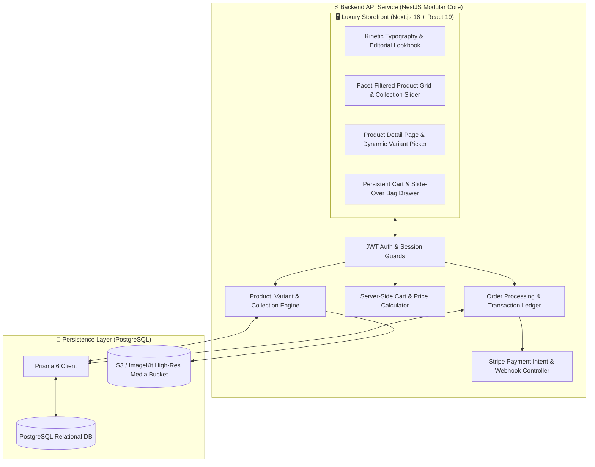
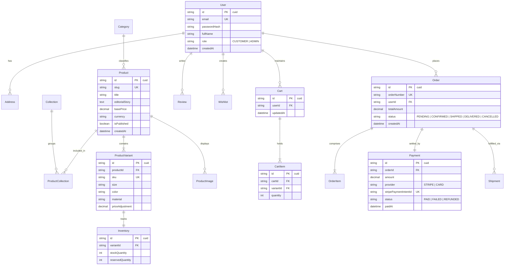
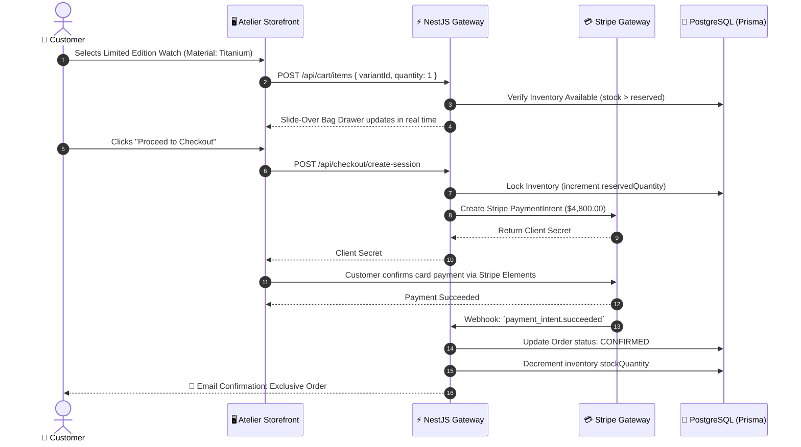

# 🛍️ Atelier Privé — Luxury Monochrome E-Commerce Experience & Fashion Engine

<div align="center">


**A disciplined, high-end monochrome e-commerce experience inspired by luxury horology and minimalist editorial design. Built with Next.js 16, React 19, NestJS, and Prisma ORM.**

[System Architecture](#-system-architecture) • [Database ERD](#-database-erd) • [Checkout Flow](#-luxury-checkout--inventory-sequence) • [Quick Start](#-quick-start)

</div>

---

## ⚡ Overview

**Atelier Privé** reimagines modern digital retail for luxury fashion, timepieces, and high-fidelity acoustics. Built with a strict black-and-white editorial aesthetic, fluid physics-based micro-interactions, and a hardened NestJS transactional backend, it provides instant sub-50ms catalog filtering, persistent cart synchronization, and encrypted multi-currency checkout.

---

## 🏗️ System Architecture



---

## 📊 Database ERD



---

## 🔄 Luxury Checkout & Inventory Sequence



---

## 🚀 Quick Start

### 1. Backend Setup (NestJS)
```bash
cd backend
pnpm install

# Push Database Schema
pnpm prisma db push

# Start Backend API (Port 4000)
pnpm run start:dev
```

### 2. Storefront Setup (Next.js 16)
```bash
cd ..
pnpm install

# Start Next.js App (Port 3000)
pnpm run dev
```

Visit `http://localhost:3000` to experience Atelier Privé.

---

## 📄 License
MIT License © **[Ros Rendo](https://github.com/RosRendo)**
