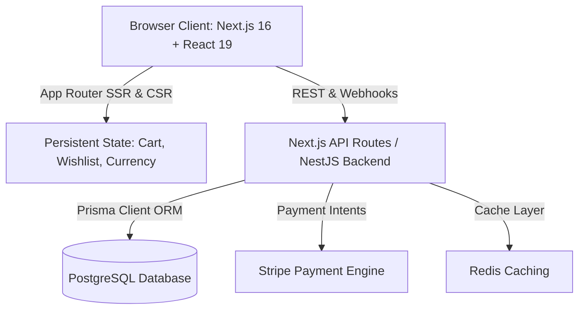

# Implementation Plan: ATELIER Monochrome Luxury Platform

**Feature ID:** SPEC-001  
**Status:** Executed & Verified  
**Architecture:** Next.js 16 (App Router) + NestJS + PostgreSQL / Prisma

---

## 1. Technical Architecture

---

## 2. Component Hierarchy & Module Boundaries

1. **Tokens & Theme (`src/app/globals.css`)**:
   - Monochrome color palette tokens (`--color-mono-50` to `--color-mono-900`).
   - Hairline border utilities (`.hairline`, `.hairline-b`, `.hairline-t`).
   - Custom minimal scrollbar and reduced-motion rules.

2. **Core Layout Primitives (`src/components/ui/`)**:
   - `button.tsx`: High-precision luxury button with letter-tracking.
   - `input.tsx`: Minimal hairline input with tracked labels.
   - `accordion.tsx`: Radix UI accordion with 45-degree rotating plus icon.
   - `badge.tsx` & `separator.tsx`: Micro-indicators.

3. **Navigation & Overlays (`src/components/navigation/`, `src/components/search/`)**:
   - `Header.tsx`: Quiet navbar with sticky on-scroll transition.
   - `SearchModal.tsx`: Cmd+K spotlight search with instant query matching.
   - `Footer.tsx`: Newsletter, global salons, and currency selector.

4. **Domain Features (`src/features/`)**:
   - `products/`: `ProductCard.tsx`, `ProductGallery.tsx`, `ProductInfo.tsx`.
   - `cart/`: `CartDrawer.tsx` with free shipping calculations.
   - `checkout/`: `CheckoutFlow.tsx` with 5-step state machine.
   - `account/`: Client portal with certificates and concierge.

5. **Audio Acoustics (`src/components/audio/`)**:
   - `AcousticVisualizer.tsx`: SVG transfer curve generator with live metrics.

6. **Relational Database (`prisma/schema.prisma` & `prisma/seed.ts`)**:
   - 19 relational entities with cascading deletes, indexes, and full seed pipeline.

7. **Backend API (`backend/src/`)**:
   - 11 NestJS modules including auth, products, cart, orders, and payments.
