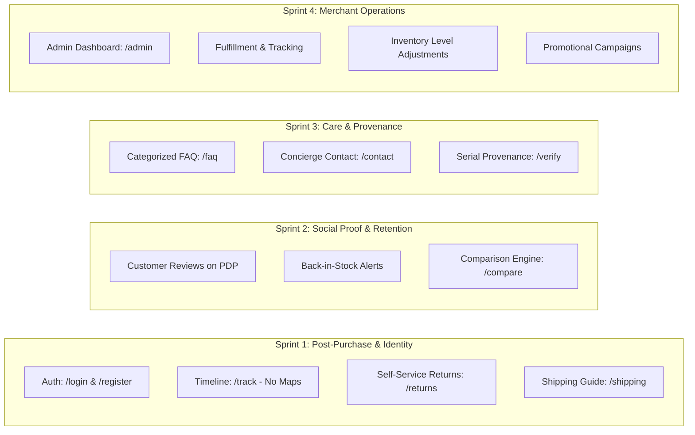

# Feature Specification: Complete Enterprise Ecommerce Suite

**Feature ID:** SPEC-002  
**Feature Branch:** `002-enterprise-ecommerce-suite`  
**Created:** 2026-09-26  
**Status:** Approved / Planning  
**Execution Strategy:** Phased Systematic Sprints  
**Input:** User direction: "that is all no missing? is that what ecommerce does? -> Full Enterprise Suite: Implement all of the above systematically across phased sprints"

---

## 1. Executive Summary & Phased Architecture

A production-grade enterprise luxury ecommerce platform requires far more than a catalog and a basic checkout. It demands an interconnected ecosystem spanning identity, post-purchase peace of mind, social validation, customer support, and merchant fulfillment operations.

The platform is divided into four systematic execution phases:

---

## 2. Sprint 1: Identity, Chronological Tracking & Post-Purchase (P1)

### User Story 1.1 - Dedicated Client Authentication & Session Persistence
- **Context**: Visitors and returning collectors need dedicated `/login` and `/register` views, as well as an accessible slide-over auth modal.
- **Requirements**:
  - Email/password validation (min 8 chars, email pattern).
  - Password visibility toggle with high-contrast indicator.
  - Integration with `AuthContext` to persist session tokens and user profile across SSR and CSR.
  - Dynamically updates [Header.tsx](file:///d:/FOR%20RENDO%20(ONLY%20)/Ecommerce/Ecommerce/src/components/navigation/Header.tsx): shows "Sign In" when unauthenticated, and "Marcus Vance / Sign Out" when authenticated.
  - Seamless redirection back to previous page or cart after login.

### User Story 1.2 - Chronological Shipment Timeline Tracking (`/track`)
- **Context**: A buyer enters their order number (e.g. `ATL-2026-891024`) or tracking code (`DHL-892410-CH`) to monitor dispatch progress.
- **Strict Constraint**: **NO MAPS**. Visual clutter and third-party map trackers are prohibited.
- **Requirements**:
  - Vertical chronological milestone timeline with hairline connectors.
  - Six distinct stages:
    1. *Acquisition Confirmed*: Order recorded and cryptographic token issued.
    2. *Precision Calibration & QC*: Hand-assembly and acoustic inspection in Zurich.
    3. *Diplomatic Air Courier Dispatch*: Sealed in linen carton via DHL Express Air.
    4. *Customs & Import Pre-Clearance*: DDP duties prepaid.
    5. *Out for Delivery*: Designated white-glove / air courier en route.
    6. *Delivered & Signature Verified*: Physical Certificate of Authenticity signed.
  - Each milestone displays verified timestamps, location coordinates, and status indicator.

### User Story 1.3 - Self-Service Returns & Exchanges / RMA Portal (`/returns`)
- **Context**: A client wishing to initiate a return or exchange within the 30-day evaluation period requires an immediate self-service portal.
- **Requirements**:
  - Query order by Order Reference + Email.
  - Itemized return reason selection (Acoustic Preference, Sizing/Fit, Aesthetic Match, Minor Cosmetic Variance).
  - Selection of resolution: Exchange for alternative finish/variant or Refund to original payment method.
  - Generation of digital Return Merchandise Authorization (RMA) slip and prepaid courier instructions.

### User Story 1.4 - Shipping & Transparency Hub (`/shipping`)
- **Context**: International collectors require crystal-clear understanding of courier corridors, transit insurance, and customs handling.
- **Requirements**:
  - Comprehensive breakdown of express delivery tiers (North America, Europe, Asia-Pacific).
  - Explicit explanation of DDP (Delivery Duty Paid) — no unexpected customs fees on delivery.
  - White-Glove delivery and acoustic room placement specifications for heavy hardware.

---

## 3. Sprint 2: Social Proof, Retention & Merchandising (P2)

### User Story 2.1 - Customer Reviews & Verified Buyer System on PDP
- **Context**: Discerning buyers require peer validation before acquiring four-figure design pieces.
- **Requirements**:
  - Display aggregate rating (e.g. 4.9/5 based on 28 reviews) and breakdown by star count.
  - Itemized customer review cards with "Verified Atelier Owner" badge, purchase date, variant owned, and review title/text.
  - Interactive "Submit an Evaluation" form allowing verified clients to write a review with star selection.

### User Story 2.2 - Back-in-Stock & Limited Archival Waitlist
- **Context**: Highly coveted numbered editions frequently sell out.
- **Requirements**:
  - When inventory drops to 0 (or for numbered limited batches), the PDP Add to Bag CTA smoothly transitions to "Join the Private Waitlist".
  - Clean email capture modal with immediate visual confirmation.

### User Story 2.3 - Technical Product Comparison Matrix (`/compare`)
- **Context**: Customers debating between audio hardware (e.g. Aether 01 Headphones vs Monolith Column) need an editorial side-by-side spec comparison.
- **Requirements**:
  - Dynamic side-by-side spec table covering Frequency Response, Drivers, Materials, Weight, Battery Life, and Impedance.
  - Direct 1-click Add to Bag from comparison columns.

---

## 4. Sprint 3: Customer Care, Salon Services & Provenance (P2)

### User Story 3.1 - Searchable Help Center & Categorized FAQ (`/faq`)
- **Context**: Instant self-service answers to eliminate pre-purchase hesitation.
- **Requirements**:
  - Categorized Radix UI accordions for Orders & Dispatch, Returns & Guarantee, Acoustic Calibration & Setup, and Payment Security.
  - Live filter search input to instantly narrow down answers.

### User Story 3.2 - Support Ticket & Client Concierge Form (`/contact`)
- **Context**: VIP clients needing personalized consultations or bespoke requests.
- **Requirements**:
  - Structured inquiry form with topic selection (Acoustic Consultation, Acquisition Assistance, Order Inquiry, Press).
  - Contact coordinates for Zurich, Tokyo, New York, and Paris ateliers.

### User Story 3.3 - Serial Number Provenance Verification (`/verify`)
- **Context**: Owners of Atelier objects input their engraved laser serial number (e.g. `SN-AETH-01-0492`) to confirm authenticity.
- **Requirements**:
  - Live lookup against registered serial database.
  - Displays object name, edition number, craftsman signature, and digital Certificate of Authenticity.

---

## 5. Sprint 4: Merchant Operations & Admin Portal (`/admin`) (P3)

### User Story 4.1 - Admin Management Console
- **Context**: Store curators and fulfillment managers need an internal dashboard to operate the business.
- **Requirements**:
  - **Orders Management**: View active orders, filter by status (`PENDING`, `PROCESSING`, `SHIPPED`, `DELIVERED`), assign carrier tracking numbers, and view customer notes.
  - **Inventory Management**: Real-time SKU stock levels, instant quantity adjustments, and low-inventory warnings.
  - **Coupon Engine**: View and generate promo codes (`ATELIER10`, `ARCHIVE20`), discount percentages, and usage counters.
  - **Key Metrics Dashboard**: Gross sales volume, Average Order Value (AOV), fulfillment velocity.

---

## 6. Edge Cases & Governance

- **Strict Monochrome Aesthetics**: All new pages (`/login`, `/register`, `/track`, `/returns`, `/shipping`, `/faq`, `/contact`, `/verify`, `/compare`, `/admin`) MUST strictly utilize the `#FFFFFF` / `#000000` / `#FAFAFA` / `#E5E5E5` palette. Zero colorful badges, zero gradients, zero maps.
- **Responsive Layout**: Every view must adapt cleanly between mobile viewport (375px) and 12-column desktop grid (1440px).
- **Graceful Mock Fallbacks**: Live database querying when PostgreSQL is connected; deterministic, elegant fallback mocks for demo evaluation so every interaction functions seamlessly out-of-the-box.

---

## 7. Success Criteria

- **SC-001**: Client can register, sign in, or sign out with session persistence across page refreshes.
- **SC-002**: Client can query any order number and view a chronological milestone timeline in under 1 second without loading any third-party map scripts.
- **SC-003**: Client can initiate a return or exchange in under 3 steps via `/returns`.
- **SC-004**: Product detail pages support reviews, star ratings, and back-in-stock waitlist captures.
- **SC-005**: All pages build cleanly with Next.js Turbopack (`pnpm build`) with 0 errors.
